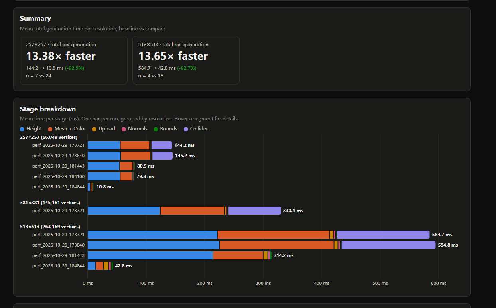
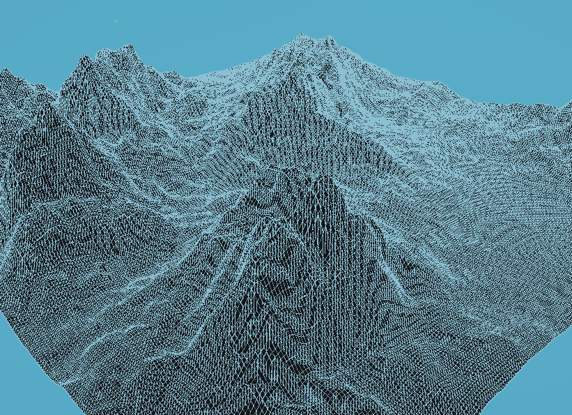

# DevLog
## Purpose: This document records my actual working hours and development notes.

## 07/09/2026 - 13/09/2026 
### Total hours: 14.5h
This week I mainly studied the algorithms needed for the whole project and the actual application architecture.

**Core algorithms:**
- Use the SplitMix64 algorithm to generate a seed-based pseudo-random number sequence, and use shuffle-based Perlin noise to make the base grayscale map.
- Use FBM to combine multiple layers of base noise into one composite grayscale map for terrain generation.


**Software architecture:**
- Use Unity UI Toolkit to make the front-end interface for adjusting parameters.
- Use the Unity Mesh API to turn the grayscale map into the actual 3D scene.
- Use the Unity Input System to make a free-fly camera.


## 14/09/2026 - 20/09/2026
### Total hours: 13h
This week I used AI tools to generate some interactive web pages to better understand the algorithms. I also referred to open-source code from the industry to implement the basic features of the core algorithms: the SplitMix64 pseudo-random number sequence, Perlin noise, and FBM. I also added the UI for control and the parameter class.

Added unit tests for debugging the algorithms, and tried to turn the final grayscale map into a mesh in the actual 3D scene. Got some early results.

Added three terrain presets
- RollingHills
- RuggedPeaks
- TerracedMesas

Created the GitHub repository and committed the basic content of the project.
Finished the Research Proposal.

**AI Use:**

Zai GLM5.3, generated the interactive algorithm web pages and part of the front-end UI UXML and USS files.

**Reference:**

aglitchman, NaakkaDev. defold-splitmix64
https://github.com/indiesoftby/defold-splitmix64/blob/main/splitmix64/src/main.cpp

eijiroKeijiro. Perlin Noise Function for Unity
https://github.com/keijiro/PerlinNoise/blob/master/Assets/Perlin.cs


## 21/09/2026 - 27/09/2026
### Total hours: 0h
No progress at all this week. I was mainly busy with other things.


## 28/09/2026 - 04/10/2026
### Total hours: 4h
This week, based on how the algorithms work, I rebuilt the core algorithms myself, including the pseudo-random number generator and Perlin noise.
Fixed the earlier gradient table problem: the y-axis gradients were not applied correctly before.
Used Gemini along the way to look up C# syntax.

(Permutation[j], Permutation[i]) = (Permutation[i], Permutation[j]);
I did not know C# could swap array values directly like this. This is the first time I learned it. It is called "Tuple Swap", and the same style can also be used in Python, Rust, Go, and JavaScript/TypeScript.

**AI Use:**
Gemini for C# syntax lookup only.


## 05/10/2026 - 11/10/2026
### Total hours: 0h
No progress at all this week. I was mainly busy with other things.


## 12/10/2026 - 18/10/2026
### Total hours: 5h
This week I redid the UI panel, so all the parameter controls are much clearer now.
Added a height color map that colors the terrain automatically based on height.
Added the DevLog to the GitHub repo.
Added skybox and lighting.

**AI Use:**
Claude Opus 5.5, fixed the UI input mix-up bug (I honestly could not figure this one out myself).
In the end, the fix was a function on the UI root that catches the input, so the UI input gets locked while the camera is moving.


## 19/10/2026 - 25/10/2026
### Total hours: 14h
This week I add color panel, users can now color the ground by using the color panel.

Fixed a bug where increasing the resolution caused the terrain to shrink; the project’s default mesh generation process used 16-bit indexing, which limited each mesh to a maximum of 65,535 vertices.

```
mesh.indexFormat = meshData.Vertices.Length > 65535 ? IndexFormat.UInt32 : IndexFormat.UInt16;
```

Compare based on the number of vertices and use a larger data format.

The evaluation direction and plan were defined this week; for further details, please refer to the Final Project Report.


## 26/10/2026 - 01/11/2026
### Total hours: 20h
This week, I created a PrefLog utility for performance evaluation; it records the time taken for each step during terrain generation (measured in milliseconds). Initial analysis revealed three primary performance bottlenecks: heightmap generation, mesh data generation, and collider generation. Furthermore, the performance cost increases exponentially with the resolution, as all three processes have a time complexity of O(n²).

To address this, I plan to implement multi-core parallel processing (utilizing the CPU), remove unnecessary collider generation, and cache the heightmaps to accelerate color-filling operations.



Based on the details shown in the image above, I have implemented two key optimizations:
First, I removed unnecessary collider generation and introduced heightmap data caching to speed up color-filling operations.
Second, I implemented CPU-based parallel processing.
In total, these changes have resulted in a 13.x-fold performance improvement.

Subsequently, two brief rounds of playtesting were conducted (see the appendix for the playtest forms), yielding two pieces of feedback.

- 1.A wireframe version of the terrain. A short description for each adjusting property when hovering over it using a mouse.
- 2.I wish the color palette were adjustable; otherwise, everything else is fine.

Then, based on feedback, a color palette and a grid display feature were added.



**AI Use:**
Opus5.5, Develop data analysis tools to visualize and compare performance data.


